<div align="center">

# Apollo N

**A 3D Moon mission you fly in the browser, built on real NASA data and written from this week's lunar news.**

Build a lander, suit up your crew, launch, find a safe spot on real south-pole terrain, fly the descent and walk on the Moon.
Solo or with up to four friends.


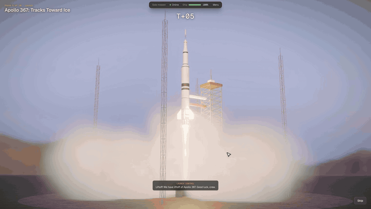

</div>

## Gameplay video

A full solo mission recorded in the game, from the menu to the mission report, cut to two minutes with the game's own music, radio and sound effects.
Every frame is the real game screen with its HUD, played at normal speed in long takes. The mouse pointer, clicks and pressed keys are drawn on top so you can follow what the player does.

<div align="center">

[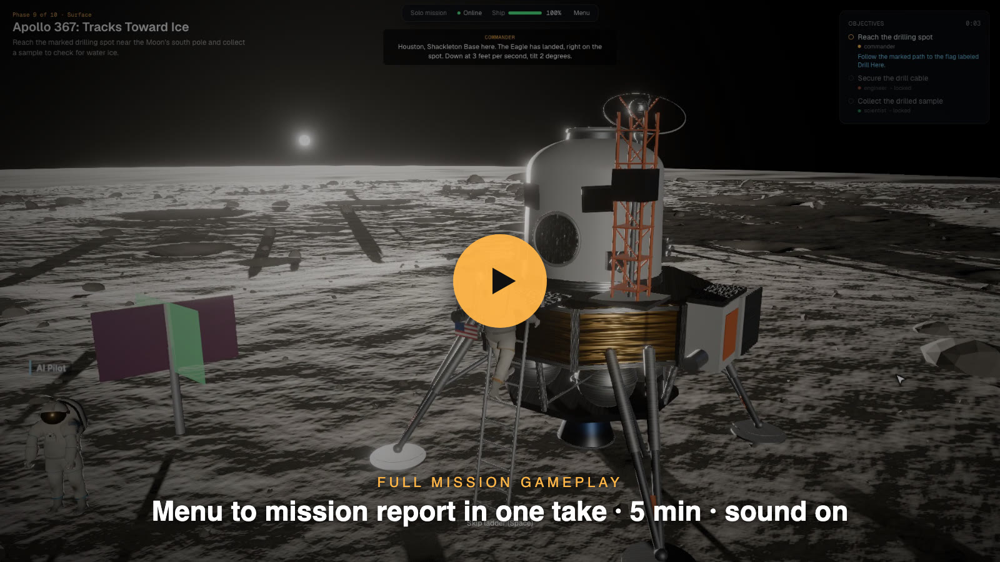](https://youtu.be/VIDEO_ID)

</div>

## The mission

Every level is one mission from the pad to the surface. Each phase is a different kind of play.

<table>
  <tr>
    <td width="50%">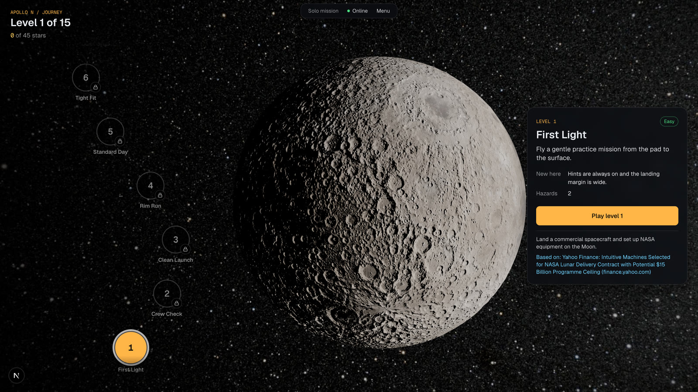</td>
    <td width="50%">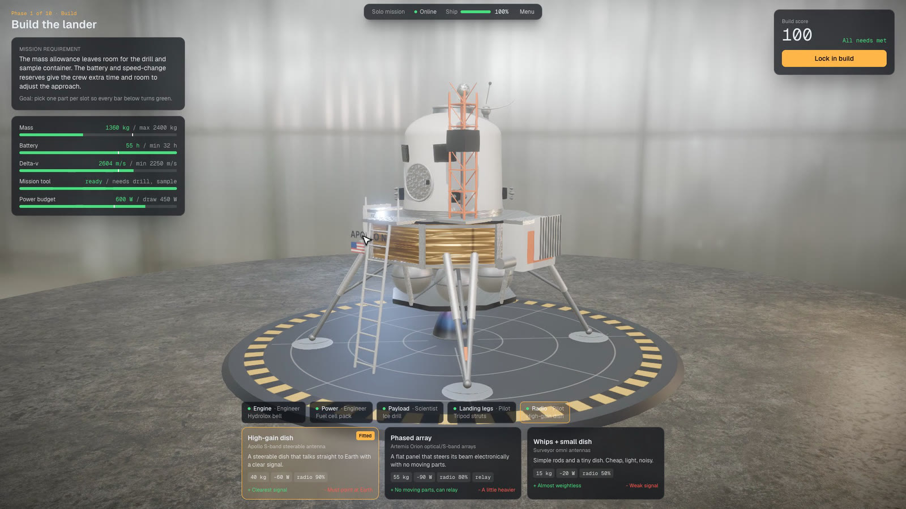</td>
  </tr>
  <tr>
    <td><b>Pick a level.</b> Fifteen levels on the journey map. Each mission is written from a real, recent lunar news story, and the card links to it.</td>
    <td><b>Build the lander.</b> Choose engine, power, payload, legs and radio. Mass, power and leg tolerance are checked against the mission's limits.</td>
  </tr>
  <tr>
    <td>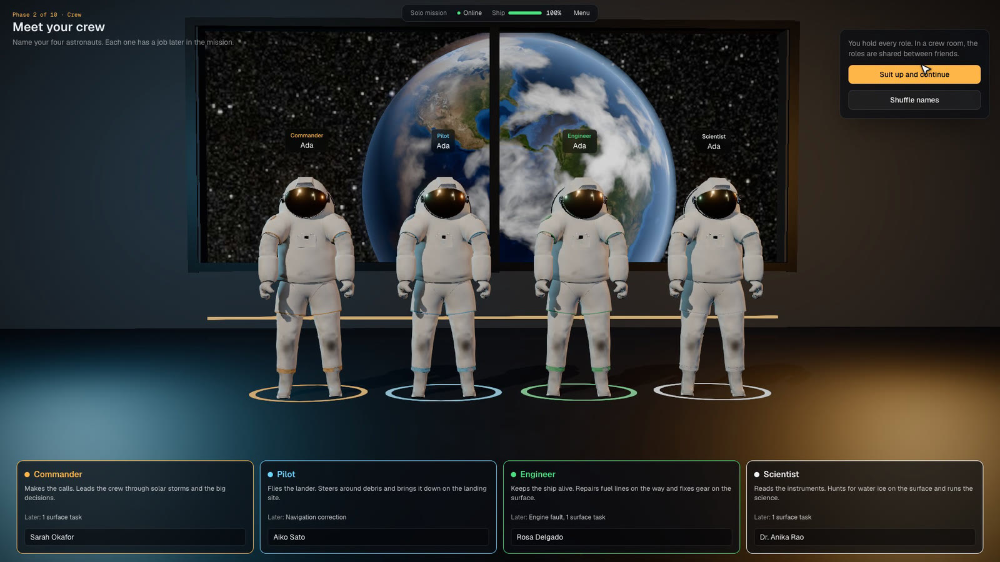</td>
    <td>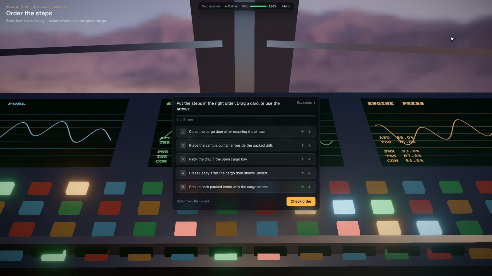</td>
  </tr>
  <tr>
    <td><b>Name the crew.</b> Commander, pilot, engineer and scientist. Each role owns real jobs later on.</td>
    <td><b>Run the checklist.</b> Launch Control's pre-flight check as a quiz, step order, memory match or switch panel.</td>
  </tr>
  <tr>
    <td>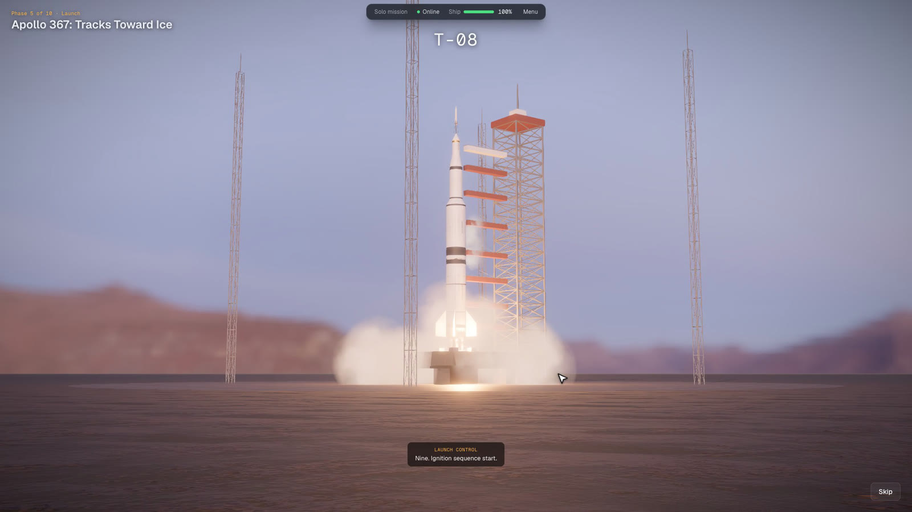</td>
    <td>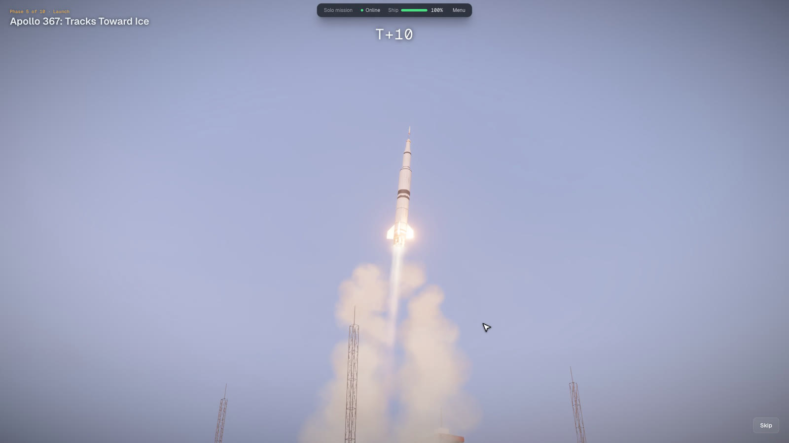</td>
  </tr>
  <tr>
    <td><b>Launch.</b> Countdown, ignition, liftoff and staging, with mission-control voices over the radio loop.</td>
    <td><b>Ascent.</b> The stack climbs out of the atmosphere and heads for translunar injection.</td>
  </tr>
  <tr>
    <td>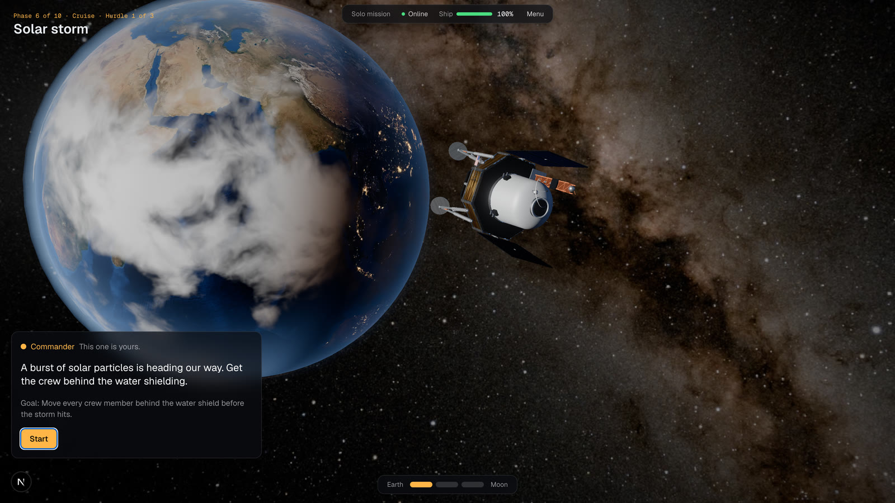</td>
    <td>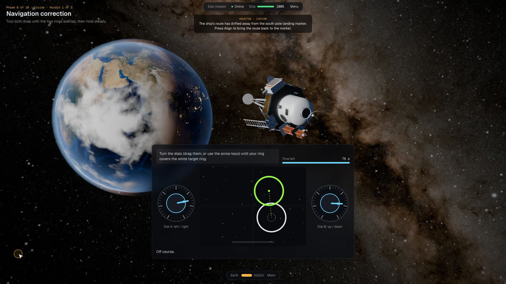</td>
  </tr>
  <tr>
    <td><b>Cruise to the Moon.</b> Earth and Moon at their true angular size along the trip.</td>
    <td><b>Hurdles on the way.</b> Solar storms, debris fields, engine faults, navigation corrections and comms blackouts, each owned by one crew role.</td>
  </tr>
  <tr>
    <td>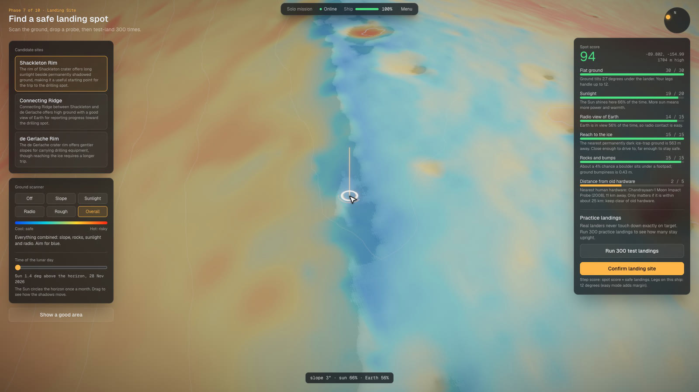</td>
    <td>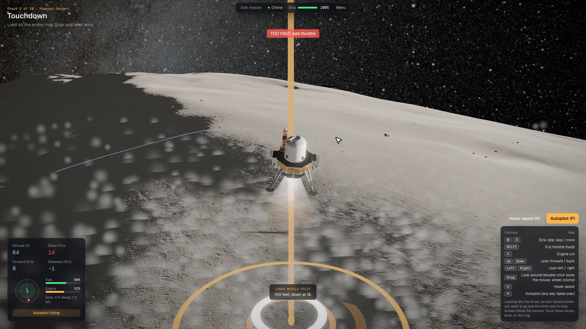</td>
  </tr>
  <tr>
    <td><b>Find a safe landing spot.</b> Scan slope, sunlight, radio view of Earth and roughness on real terrain, drop a probe, then run 300 simulated landings.</td>
    <td><b>Fly the descent.</b> Lunar gravity, a fuel budget and engine dust. Fly it by hand with hover assist, or hand it to the autopilot.</td>
  </tr>
  <tr>
    <td>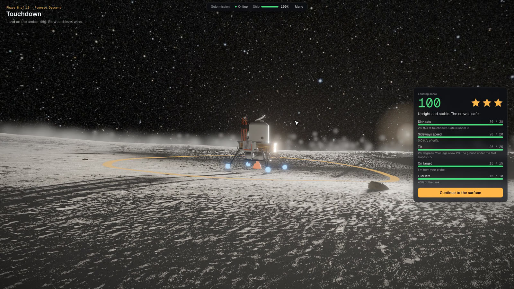</td>
    <td>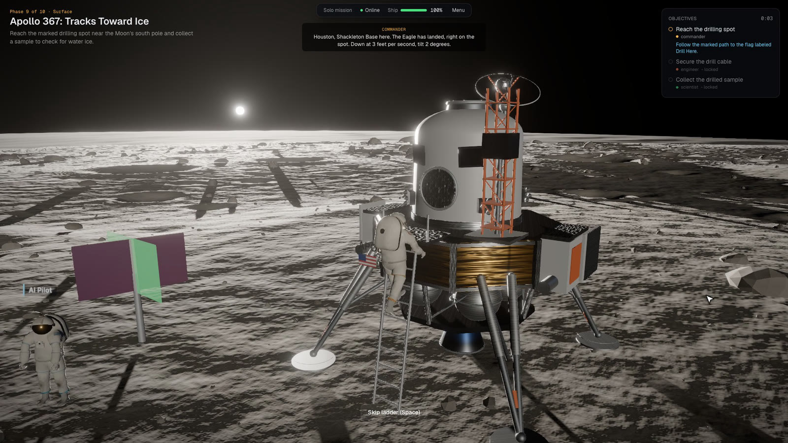</td>
  </tr>
  <tr>
    <td><b>Touchdown.</b> Scored on sink rate, sideways drift, tilt against your legs' limit, distance to target and fuel left.</td>
    <td><b>Walk on the Moon.</b> Climb down the ladder, carry out the mission's surface tasks, then explore freely with an AR overlay of real landing sites and hardware.</td>
  </tr>
  <tr>
    <td>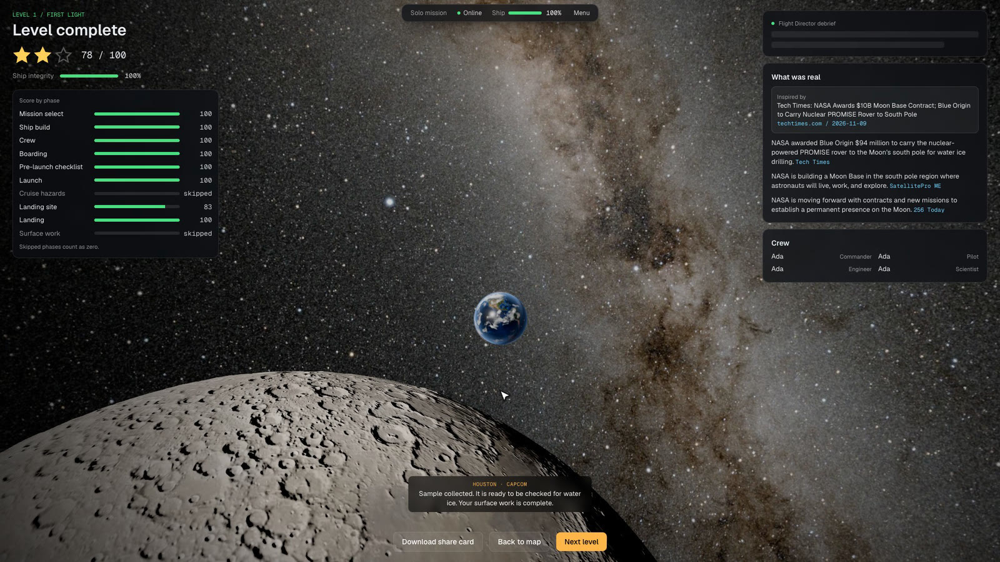</td>
    <td>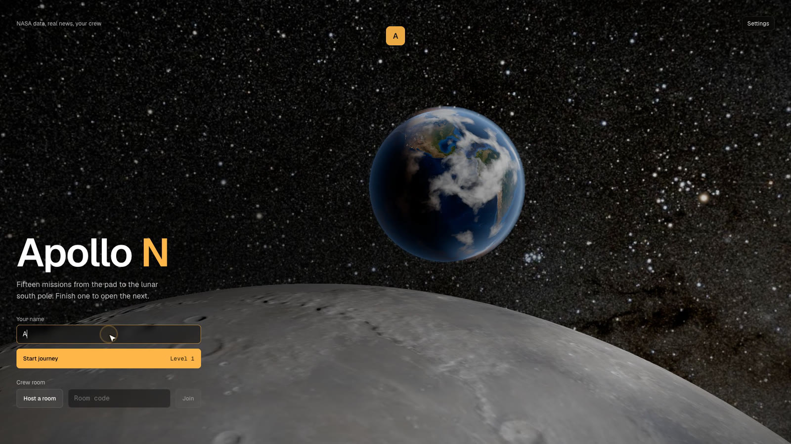</td>
  </tr>
  <tr>
    <td><b>Mission report.</b> Score by phase, stars, and "what was real": the news and science the mission was built from, with sources.</td>
    <td><b>Solo or co-op.</b> Play alone with an AI crew, or host a room and share the mission with up to four players.</td>
  </tr>
</table>

## What is real

| | Source |
|---|---|
| Lunar south-pole terrain, slopes, roughness | NASA LRO **LOLA** elevation models (5 m/px) |
| Sunlight and Earth visibility over the lunar day | NASA Goddard **PGDA** illumination maps |
| Sun, Earth and Moon positions on the mission date | **JPL Horizons** ephemeris |
| Mission stories | Recent lunar news found through **SerpApi**, turned into a mission plan with the source cited |
| Heritage sites in explore mode | Positions and history of past landers, with **NASA Images** and web results |
| Flight physics | Lunar gravity 1.62 m/s², vacuum, fuel mass, leg tolerance, 120 Hz simulation |
| Voices | Mission control and crew lines voiced with **ElevenLabs v3**, played through a radio chain with Quindar tones |

Every downloaded asset and dataset is listed with its license in [`assets-src/credits/`](assets-src/credits/).

## Run locally

```bash
# API (Python 3.12, uv)
cd api && cp .env.example .env   # fill SERPAPI_KEY, optionally ELEVENLABS_API_KEY
uv run uvicorn app.main:app --reload --port 8000

# Web
cd web && pnpm install && pnpm dev   # http://localhost:3000  (add ?perf or press ` for the perf overlay)
```

> [!TIP]
> `LLM_PROVIDER=codex` writes missions with the local `codex` CLI (ChatGPT sign-in, dev only); use `LLM_PROVIDER=openai` with `OPENAI_API_KEY` when hosting.
> `VOICE_PROVIDER=elevenlabs` with `ELEVENLABS_API_KEY` gives the full voice cast; `system` falls back to the browser's speech voice.

### Controls

| Where | Keys and mouse |
|---|---|
| Everywhere | <kbd>Esc</kbd> menu (volume, quality, skip a phase as host) |
| Landing | <kbd>W</kbd> / <kbd>S</kbd> sink rate, <kbd>Shift</kbd> full throttle, arrows fly that way, <kbd>H</kbd> hover assist, <kbd>P</kbd> autopilot, drag to look, wheel to zoom |
| Surface | <kbd>W</kbd> <kbd>A</kbd> <kbd>S</kbd> <kbd>D</kbd> or arrows walk, <kbd>Shift</kbd> sprint, <kbd>Space</kbd> jump (or skip the ladder), <kbd>E</kbd> interact or open a tag, drag to look, double-click locks the mouse, wheel to zoom |

### Recording the gameplay video

```bash
cd web && node scripts/gameplay-video.mjs   # API and web dev server running; writes /tmp/gameplay/gameplay.mp4
```

The script plays a full solo mission through the real UI at high quality, records the screen and the game's audio, and draws the pointer, clicks and keys (`scripts/input-overlay.js`, `scripts/audio-tap.js`). `--from=<phase>` records just part of the run.
`python3 scripts/gameplay-cut.py` cuts that recording to two minutes of long takes joined by short dips to black; its cut list holds the start and end of every take.

## Documentation

Full docs are in [`docs/`](docs/README.md):

- [Getting started](docs/getting-started.md): setup, configuration, controls, deploying
- [Architecture](docs/architecture.md) and [Multiplayer](docs/multiplayer.md): game state, phases, rooms and the WebSocket protocol
- [Gameplay](docs/gameplay.md): every phase, its controls and how it is scored
- [Missions](docs/missions.md): the plan format and how missions are written from the news
- [API reference](docs/api.md)
- [Science and data](docs/science.md): NASA datasets, the site score and the Monte Carlo landings
- [Audio](docs/audio.md), [Development](docs/development.md), [Known issues](docs/known-issues.md)
